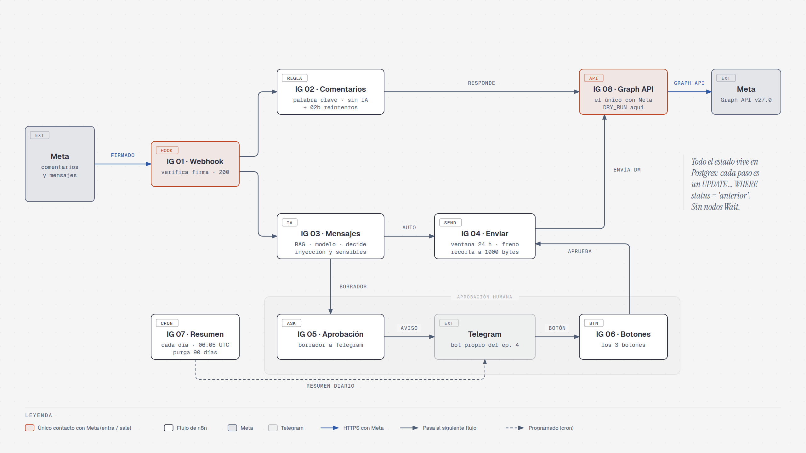

# instagram-agent-n8n

Agente de Instagram del episodio 4 de **Mi Empleado Digital**. Hace dos cosas, cada una con su flujo:

- **Comentarios con palabra clave.** Alguien comenta «guía» en una publicación. El sistema le manda una respuesta privada (un mensaje directo con el enlace) y responde en público al comentario. Sin IA: es una tabla de palabras clave (`ig_keywords`) y plantillas que tú escribes.
- **Mensajes directos.** Alguien escribe por DM. El sistema busca en la base de conocimiento del episodio 2 (RAG), clasifica con un modelo y decide: si la pregunta es clara, está en las fuentes y no toca nada sensible, contesta solo. Si hay la menor duda, te manda el borrador a Telegram con Aprobar / Editar / Rechazar.

Todo el estado vive en PostgreSQL, igual que en el episodio 3: no hay nodos Wait, y si n8n se reinicia, el botón de Telegram sigue valiendo.

Estado de este documento: la parte de Meta está escrita a partir de la documentación oficial consultada el **2026-11-09** (ver [Fuentes de Meta](#fuentes-de-meta)). Lo que se confirmará o corregirá con la app real lleva la marca `<!-- VERIFICADO-FASE4 -->` en el fuente de este fichero y la etiqueta **A probar** en el texto.

## Índice

1. [Los nueve flujos](#los-nueve-flujos)
2. [Qué no hace](#qué-no-hace)
3. [Requisitos y coste](#requisitos-y-coste)
4. [Instalación](#instalación)
5. [Panel de Meta, tal como está hoy](#panel-de-meta-tal-como-está-hoy)
6. [Pruebas sin Meta](#pruebas-sin-meta)
7. [Pruebas reales con la cuenta tester](#pruebas-reales-con-la-cuenta-tester)
8. [Límites y ventanas de Meta](#límites-y-ventanas-de-meta)
9. [Pasar a modo público](#pasar-a-modo-público)
10. [Seguridad y privacidad](#seguridad-y-privacidad)
11. [Resolución de problemas](#resolución-de-problemas)
12. [Estructura del repo](#estructura-del-repo)
13. [Fuentes de Meta](#fuentes-de-meta)

## Los nueve flujos

Todos llevan el prefijo `IG ` para no chocar con los del episodio 3 («01 - Ingesta»…).

<picture>
  <source media="(prefers-color-scheme: dark)" srcset="docs/diagramas/arquitectura-dark.png">
  
</picture>

Lo que hace cada flecha, por si el dibujo se queda corto:

- **IG 01** verifica la firma sobre el cuerpo crudo (403 si no cuadra), responde 200, normaliza, descarta lo propio y deduplica en `ig_events`.
- **IG 02** (con **IG 02b** cada 5 minutos para los reintentos) responde por palabra clave: privada y después pública, sin IA.
- **IG 03** filtra, consulta el RAG, clasifica con el modelo y decide: respuesta automática (**IG 04**) o aprobación (**IG 05**).
- **IG 04** comprueba la ventana de 24 h y el freno anti-bucles; si el freno salta, el mensaje vuelve a **IG 05**.
- **IG 08** es el único flujo que habla con Meta; **IG 07** vence, purga a 90 días y manda el resumen.

El dibujo está hecho con [diagram-design](https://github.com/cathrynlavery/diagram-design) (fuente HTML y SVG en [`docs/diagramas/`](docs/diagramas/)).

| Fichero | Qué hace | Disparo |
|---|---|---|
| `workflows/01-webhook.json` | Verificación GET de Meta. En el POST: firma HMAC sobre el cuerpo crudo, 200 inmediato, normaliza los eventos, descarta (eco, comentarios propios, lecturas, reacciones, postbacks…), deduplica por `comment_id` / `mid` y despacha. Sin IA. | `GET` y `POST /webhook/instagram` (público, sin cabecera: la seguridad es la firma) |
| `workflows/02-comentarios.json` | Normaliza el texto, busca palabra clave, reserva el comentario (una sola vez), manda la privada y después la pública. Errores de límite: `reintento`. | `POST /webhook/ig-comment` |
| `workflows/02b-reintentos.json` | Recoge los comentarios en `reintento` ya vencidos y vuelve a llamar al 02. Pasados 7 días los da por perdidos. | Cada 5 minutos, o el disparador manual |
| `workflows/03-mensajes.json` | Capa 1 anti-inyección, RAG, clasificación con el modelo, capa 3 (`decide`), guarda la fila y enruta. | `POST /webhook/ig-dm` |
| `workflows/04-enviar.json` | Reclama el mensaje, comprueba la ventana de 24 h y el freno anti-bucles, recorta a 1000 bytes, envía vía IG 08 y marca el resultado. | `POST /webhook/ig-send` |
| `workflows/05-aprobacion.json` | Manda a Telegram el DM, el borrador, las fuentes y el motivo, con Aprobar / Editar / Rechazar. Solo escribe el `telegram_message_id` en la fila y termina. | `POST /webhook/ig-approval` |
| `workflows/06-botones.json` | Recibe el botón (solo del chat autorizado), aplica el cambio de estado, pide el texto si es Editar y llama al 04. | Telegram Trigger (bot nuevo) y `POST /webhook/ig-button-test` (pruebas) |
| `workflows/07-resumen.json` | Vence aprobaciones y ventanas, purga lo viejo y manda el resumen del día. Flujo propio: no se toca el 05 del episodio 3. | Diario 06:05 UTC, o el disparador manual |
| `workflows/08-graph.json` | **Único sitio que habla con Meta**: `public_reply`, `private_reply`, `send_dm`, `get_profile`. En DRY_RUN no llama: escribe en `ig_graph_log`. Clasifica los errores de Meta. | `POST /webhook/ig-graph` |

Los webhooks internos (todos menos `/webhook/instagram`) llevan la credencial `Instagram API Key` (cabecera `X-IG-API-Key`) y n8n se llama a sí mismo por `http://localhost:5678`.

### Por qué hay tantos flujos

Por la misma razón que en el episodio 3: cada flujo es una responsabilidad y cada paso es un `UPDATE ... WHERE status = '<el de antes>'` en una sola sentencia. Si Meta reintenta un webhook, si pulsas dos veces un botón o si dos DM del mismo usuario llegan a la vez, solo una ejecución cambia la fila. Los estados y quién los mueve están al principio de `schema.sql`.

## Qué no hace

| No hace | Por qué |
|---|---|
| **No comprueba si el usuario sigue a la cuenta.** | Los campos `is_user_follow_business` / `is_business_follow_user` existen, pero Meta exige el consentimiento del usuario: «User consent is required to access user profile» si solo ha comentado y no ha escrito nunca por DM [F12c][F20]. No sirve en el momento del comentario. Consecuencia: la privada llega a la bandeja principal si te sigue y a **Solicitudes** si no [F10]. |
| **No usa `human_agent`.** | La etiqueta (ventana de 7 días) es para respuestas de una persona, no de un bot, y la página de permisos de Unified Login no la lista [F4][F21b]. La ventana de un DM es de 24 h y se respeta tal cual. |
| **No publica nada.** | Los permisos mínimos son `instagram_basic`, `instagram_manage_comments` e `instagram_manage_messages`. No se pide `instagram_content_publish`. |
| No inicia conversaciones. | Solo responde a un comentario (una privada) o a un DM recibido dentro de su ventana. |
| No contesta a comentarios que son respuestas a otro comentario, ni a los propios. | Se descartan con motivo `reply_to_reply` y `own_comment`. |
| No lee adjuntos, notas de voz ni imágenes. | Un DM sin texto se guarda como `ignorado` y no se contesta. |
| No modera comentarios (ocultar, borrar). | No es el objetivo. |
| No avisa al usuario de que habla con un bot. | Meta lo pide «cuando lo exija la ley» [F27][F12b]. Si el borrador debe decirlo, escríbelo en `prompts/clasificador.md`. |

## Requisitos y coste

Partes de los episodios anteriores, ya funcionando: Coolify, PostgreSQL + pgvector, n8n 2.10.2 con task runners externos (`n8nio/runners:2.10.2`), el RAG del episodio 2 (`POST /webhook/rag-search` y `POST /webhook/rag-index-repo`) y los embeddings. Del episodio 3, las credenciales `LLM API` y, si quieres compartir la FAQ, su documento `FAQ de soporte`.

| Pieza | Qué hace falta | Coste |
|---|---|---|
| n8n, PostgreSQL + pgvector, embeddings | Ya instalados (episodio 2) | Los de tu servidor; este episodio no añade servicios |
| Modelo | DeepSeek Flash (`deepseek-flash`), API compatible con OpenAI. Solo se llama en los DM, nunca en los comentarios | De pago por uso. Tarifa de abajo |
| Telegram | Un **segundo bot** (BotFather) | Gratis |
| Dominio n8n con HTTPS y certificado válido | Meta no acepta autofirmados [F6] | El que ya tengas |
| Meta | Portfolio empresarial, app de desarrollador y una cuenta profesional de Instagram, pública | Coste de la API: no consta en la documentación consultada |

Tarifa de DeepSeek, copiada del README del episodio 3 (oficial a 29 de octubre de 2026, https://api-docs.deepseek.com/quick_start/pricing), por millón de tokens:

| | Fuera de punta | Punta |
|---|---|---|
| Entrada sin caché | 0,15 $ | 0,30 $ |
| Entrada cacheada | 0,003 $ | 0,006 $ |
| Salida | 0,60 $ | 1,20 $ |

La hora punta es de 01:00 a 04:00 y de 06:00 a 10:00 UTC, de lunes a viernes. Vuelve a mirar la página antes de fiarte de estos números.

`IG 03` guarda en cada fila `llm_tokens_in`, `llm_tokens_out` y `llm_ms`, así que el gasto real sale de la propia base:

```sql
SELECT count(*) AS dm, round(avg(llm_tokens_in)) AS tokens_in, round(avg(llm_tokens_out)) AS tokens_out, round(avg(llm_ms)) AS ms
FROM ig_messages WHERE llm_tokens_in IS NOT NULL;
```

<!-- MEDIDAS: tokens de entrada y salida medios por DM, latencia del modelo y coste por cada mil DM, con el RAG del episodio 2 y la FAQ de Taller Norte. Rellenar tras las pruebas. -->
Medido en este episodio: <!-- MEDIDAS --> (tokens por DM, latencia del modelo, coste por mil DM). Para tener una referencia, el episodio 3 midió unos 1.687 tokens de entrada y 172 de salida por correo, unos 0,0003 $.

RAM del contenedor de runners y de n8n con el flujo en marcha: <!-- MEDIDAS -->.

## Instalación

El orden importa: base de datos, runners, credenciales, importar, configurar, indexar, palabras clave. La parte de Meta va después ([Panel de Meta](#panel-de-meta-tal-como-está-hoy)) porque Meta necesita que el flujo 01 ya esté publicado para verificar la URL.

### 1. Esquema de PostgreSQL

Mismo PostgreSQL de los episodios 2 y 3 (host `knowledge-db`, base `knowledge`):

```bash
psql "$DATABASE_URL" -v ON_ERROR_STOP=1 -f schema.sql
```

Crea ocho tablas con prefijo `ig_`: `ig_events`, `ig_keywords`, `ig_comments`, `ig_contacts`, `ig_messages`, `ig_auto_gate`, `ig_actions` e `ig_graph_log`. No toca `knowledge_*` ni `mail_*`. Es idempotente (se puede aplicar dos veces) y siembra una palabra de demostración, `guia`, con un enlace de ejemplo.

### 2. Task runners: firma de Meta

La firma `X-Hub-Signature-256` la verifica un Code node de **Python** (`src/signature.py`) que lee el secreto de la app de Meta de una variable del contenedor `task-runners`. Qué hay que hacer, en Coolify, en el servicio de n8n (el mismo procedimiento del episodio 3: *File Mount*, compose y reinicio):

1. El fichero montado en `/etc/n8n-task-runners.json` del contenedor `task-runners` pasa a ser `runners/n8n-task-runners.json` de este repo. Es el del episodio 3 con dos cambios, ambos en el runner de **Python** (el de JavaScript no cambia):
   - `IG_APP_SECRET` en `allowed-env`.
   - `base64`, `hashlib` y `hmac` en `N8N_RUNNERS_STDLIB_ALLOW` (queda `base64,email,hashlib,hmac,os,re,smtplib,ssl`).
   - `N8N_BLOCK_RUNNER_ENV_ACCESS=false` ya estaba (lo puso el episodio 3 para `SMTP_*`).
2. En el compose, servicio `task-runners`, en `environment`, una línea más:

   ```yaml
   - IG_APP_SECRET=${IG_APP_SECRET}
   ```
3. Crea la variable `IG_APP_SECRET` en Coolify. Hasta que conectes Meta puedes poner un secreto inventado (el mismo que usarás en `.env` para firmar las pruebas). Cuando conectes la app real, pones aquí la **clave secreta de la app** ([paso 11 del panel](#panel-de-meta-tal-como-está-hoy)) y reinicias.
4. Reinicia el servicio **entero** (n8n, task-runners y la base de n8n) para que el runner lea el JSON y la variable.

**Por qué no está en `Configuración` ni en `$env`.**

- En `Configuración` se vería en cámara y quedaría guardado en los datos de cada ejecución.
- `$env` no funciona: lo resuelve n8n, no el runner, y la plantilla de Coolify trae `N8N_BLOCK_ENV_ACCESS_IN_NODE=true`.

**Por qué la firma la verifica el runner de Python y no el de JavaScript.** En n8n 2.10.2 el Code node de JavaScript no tiene `process` en su contexto, y `N8N_BLOCK_RUNNER_ENV_ACCESS` no existe en ese runner. La única vía sería abrir `process` con `NODE_FUNCTION_ALLOW_BUILTIN=crypto,process`, y eso da también `process.binding`, es decir, ejecutar comandos desde cualquier Code node de JavaScript. Se descartó. El runner de Python solo ve las variables de su `allowed-env`. Todo el detalle y las pruebas están en [`docs/spike-firma.md`](docs/spike-firma.md).

El flujo hace: Webhook (GET + POST, `rawBody`) → `Cuerpo crudo` (JavaScript: saca los bytes exactos y la cabecera) → `Verificar firma` (Python) → `¿Firma ok?` → responde 200 y sigue, o responde 403 y no hay nada conectado detrás. La firma se calcula sobre el cuerpo tal cual llegó, no sobre el JSON reserializado.

**Riesgo conocido.** Con `os` permitido, cualquier Code node de Python de esta instancia puede leer las variables del runner (`IG_APP_SECRET` y `SMTP_*`) y ejecutar comandos dentro del contenedor de runners. Ya era así en el episodio 3. Es razonable si eres la única persona que edita flujos; si no, no lo hagas así.

### 3. Credenciales de n8n

Créalas **antes de importar**, con estos nombres exactos y estos tipos. Los nodos piden la credencial por nombre: si existe una con ese nombre y ese tipo, n8n la enlaza sola al importar. El JSON no trae secretos.

| Credencial en n8n | Tipo | Qué lleva | Quién la usa |
|---|---|---|---|
| `PostgreSQL` | Postgres | La del episodio 2: host `knowledge-db`, puerto 5432, base `knowledge`. | Todos los nodos de base de datos. |
| `RAG API Key` | Header Auth, cabecera `X-RAG-API-Key` | La clave que inventaste en el episodio 2. | `IG 03`, nodo «Buscar RAG». |
| `LLM API` | Header Auth, cabecera `Authorization`, valor `Bearer sk-...` | La del episodio 3 (consola de DeepSeek). | `IG 03`, nodo «Clasificar». |
| `Instagram Token` | Header Auth, cabecera `Authorization`, valor `Bearer <token>` | El token del system user de Meta ([paso 5 del panel](#panel-de-meta-tal-como-está-hoy)). **Nueva.** | `IG 08`, nodos «Llamar a Meta» y «Consultar perfil». |
| `Instagram API Key` | Header Auth, cabecera `X-IG-API-Key` | Una clave que te inventas. La misma en los webhooks internos y en quien los llama. **Nueva.** | Webhooks de IG 02, 03, 04, 05, 06 (prueba) y 08, y los nodos HTTP que los llaman. |
| `Telegram Instagram` | Telegram API | Token de un bot **nuevo** (BotFather, `/newbot`). **Nueva.** | Trigger y envíos de IG 06, y los avisos de IG 01, 02, 03, 04, 05 y 07. |

**Por qué un segundo bot.** Un bot de Telegram solo puede tener **un** webhook. Si `IG 06` usara el bot del episodio 3, al publicarse le quitaría el webhook al flujo `03b - Botones` del correo y rompería el episodio 3. Con un bot nuevo conviven los dos. El chat id sale al escribirle al bot y abrir `https://api.telegram.org/bot<TOKEN>/getUpdates`.

Sin el bot nuevo todo funciona menos los botones: publica `IG 06` con el nodo *Telegram Trigger* desactivado (sin publicarlo no existe `/webhook/ig-button-test`) y simula los botones con `/webhook/ig-button-test` (ver [Pruebas sin Meta](#pruebas-sin-meta)).

### 4. Importar y publicar los nueve flujos

En n8n: *Workflows → Import from File* y sube los nueve JSON de `workflows/`. Entran sin publicar.

Después de rellenar `Configuración` (paso 5), publica (*Publish*) en este orden: **08, 04, 05, 03, 02, 02b, 07, 01 y 06 el último**. El 01 es el que recibe a Meta, así que va casi al final. El 06 registra el webhook del bot de Telegram al publicarse, y solo debe publicarse con el bot nuevo.

### 5. Rellenar los nodos «Configuración»

Cada flujo lleva un nodo `Configuración` con solo los campos que usa. Es el mismo sitio que en los episodios 2 y 3: la plantilla de Coolify bloquea `$env`, y los secretos no van aquí. El `.env.example` es una lista de lo que tienes que tener a mano; los flujos no lo leen.

| Campo | Flujos | Valor de serie | Qué poner |
|---|---|---|---|
| `verify_token` | 01 | `cambia-esto` | Te lo inventas. El mismo valor va en el panel de Meta. Tiene que ser un valor literal, no una expresión (el flujo lo lee sin ejecutar el nodo). |
| `ig_account_id` | 01, 02, 08 | `cambia-esto` | El ID de la cuenta profesional de Instagram que sale de `GET me/assigned_instagram_accounts` (por ejemplo `17841400000000001`). **Nunca** el `id` de `/me`. |
| `ig_username` | 01 | `cambia-esto` | El usuario de la cuenta, sin `@` (por ejemplo `taller_norte_demo`). Sirve para descartar tus propios comentarios. |
| `dry_run` | **08** | `true` | `true`: no llama a Meta, escribe en `ig_graph_log`. `false`: envía de verdad. **Es el único sitio donde se cambia**; 02 y 04 lo heredan porque llaman al 08. Es un texto, `true` o `false`. |
| `graph_base`, `graph_version` | 08 | `https://graph.facebook.com`, `v27.0` | La documentación de Instagram usa `v27.0`. Si falla, prueba `v26.0` ([ver nota](#versión-de-la-api)). |
| `n8n_url` | 01, 02, 02b, 03, 04, 05, 06 | `http://localhost:5678` | n8n se llama a sí mismo, sin salir a internet. |
| `telegram_chat_id` | 01, 02, 03, 04, 05, 06, 07, 08 | `cambia-esto` | Tu chat con el bot nuevo (número). Mientras valga `cambia-esto` no se envía nada a Telegram (el flujo lo salta y deja el rastro en `ig_actions`), y en 06 no vale nadie. |
| `telegram_user_ids` | 05, 06 | vacío | Vacío si el chat es privado. En un grupo, los ids de quienes pueden decidir, separados por comas. |
| `max_attempts` | 02, 02b | `6` | Intentos de la respuesta privada ante errores de límite. |
| `window_days` | 02, 02b | `7` | Días de plazo de la respuesta privada. Es el máximo de Meta; no lo subas. |
| `confidence_threshold` | 03 | `0.75` | Confianza mínima para contestar solo. |
| `min_rag_score` | 03 | `0.45` | Puntuación mínima de la mejor fuente del RAG. |
| `sensitive_topics` | 03 | precio, contrato, devolución, DNI, IBAN, contraseña… | Palabras que mandan siempre a una persona, separadas por comas. Lista completa en el nodo. |
| `llm_base_url`, `llm_model` | 03 | `https://api.deepseek.com`, `deepseek-flash` | Otro proveedor compatible con OpenAI: cambia estos dos. La credencial `LLM API` es solo la clave. |
| `rag_url` | 03 | `http://localhost:5678/webhook/rag-search` | El RAG del episodio 2, si vive en el mismo n8n. |
| `rag_source_type` | 03 | `repo` | `repo` busca solo en los documentos indexados desde repositorios (las dos FAQ). Con `all` se cuelan transcripciones de vídeos con score alto (ver «Dónde busca» en el README del episodio 3). |
| `loop_minutes` | 03, 04 | `10` | Freno anti-bucles. Pon el **mismo** valor en los dos. |
| `window_hours` | 03, 04 | `24` | Ventana del DM. Es el máximo de Meta: más de 24 se recorta a 24. |
| `approval_hours` | 04, 05, 06 | `24` | Plazo para decidir en Telegram. Nunca más allá de la ventana de 24 h. |
| `retention_days` | 07 | `90` | Retención de las tablas `ig_*`. |
| `prompt` | 03 | contenido de `prompts/clasificador.md` | El prompt de sistema. Se puede editar aquí y el siguiente DM ya lo usa. |

En el trigger de Telegram de `IG 06` **no** uses *Restrict to Chat IDs*: en n8n 2.10.2 mira `message.chat.id`, que un botón no trae, y descartaría todos los botones. El filtro está en el nodo «Leer update».

### 6. Indexar la FAQ de Instagram

`kb/faq-instagram.md` es una FAQ pequeña e inventada (Taller Norte): horario por DM, cómo conseguir la guía con la palabra clave y qué no se contesta por DM. Se suma a la `FAQ de soporte` del episodio 3, así que correo e Instagram comparten un solo cerebro.

**Ojo con `replace_all`.** El flujo `04 - Indexar repositorio` del episodio 2 (`POST /webhook/rag-index-repo`) exige `replace_all: true` y trata cada lote como el estado **completo** de los documentos `repo` y borra del índice los que no vengan en él. Si mandas solo la FAQ de Instagram, desaparece la del episodio 3. Por eso la FAQ de Instagram **no se manda sola**: va en el mismo lote que la del episodio 3, con las dos rutas de los dos repos.


```bash
jq -n --rawfile soporte ../email-agent-n8n/kb/faq-soporte.md --rawfile instagram kb/faq-instagram.md '{
  replace_all: true,
  documents: [
    { source_type: "repo", external_id: "email-agent/faq-soporte.md",
      title: "FAQ de soporte", collection: "repositorio", content: $soporte },
    { source_type: "repo", external_id: "instagram-agent/faq-instagram.md",
      title: "FAQ de Instagram — Taller Norte", collection: "repositorio", content: $instagram }
  ]
}' | curl -sS -X POST https://n8n.tudominio.com/webhook/rag-index-repo \
  -H 'X-RAG-API-Key: <clave>' \
  -H 'Content-Type: application/json' \
  --data-binary @-
```

Si ya tienes más documentos de repo, mándalos todos en el mismo lote. Es asíncrono: responde `Workflow was started` y el indexado tarda unos 20 s. Comprueba que salen las dos FAQ antes de seguir:

```bash
curl -sS -X POST https://n8n.tudominio.com/webhook/rag-search \
  -H 'X-RAG-API-Key: <clave>' -H 'Content-Type: application/json' \
  -d '{"query": "horario de los mensajes directos", "limit": 5, "source_type": "repo"}'
```

### 7. Cargar las palabras clave

Las palabras clave están en `ig_keywords` y se editan con cualquier cliente SQL. Ejemplo inventado, una palabra para todas las publicaciones y otra solo para una:

```sql
INSERT INTO ig_keywords (keyword, media_id, public_replies, private_message, link) VALUES
('taller', NULL,
 ARRAY['¡Te lo mando por mensaje privado! 📩',
       '¡Hecho! Mira tus mensajes, te acabo de escribir 📬',
       '¡Enviado! Revisa tus mensajes directos 🙌'],
 E'Hola 👋 Aquí tienes la lista de materiales del taller.\n\nSi tienes cualquier duda, escríbeme por aquí.',
 'https://taller-norte.example.com/lista-materiales'),
('presupuesto', '18050000000000001',
 ARRAY['¡Te escribo ahora mismo por privado!'],
 E'Hola 👋 Para el presupuesto, cuéntame qué necesitas y te contesta una persona del equipo.',
 NULL);

-- La palabra de demostración que trae schema.sql: desactívala antes de ir a producción.
UPDATE ig_keywords SET active = false WHERE keyword = 'guia';
```

Reglas:

- `keyword` se compara normalizada (minúsculas, sin acentos, sin emojis) y por **palabra completa o frase**: «guia» coincide con «GUÍA 🙌» y con «guia por favor», no con «guiarse».
- `media_id` nulo vale para todas las publicaciones. Con valor, solo para esa. Si coinciden las dos, gana la de la publicación concreta, y después la palabra más larga.
- `public_replies` tiene al menos una variante; se rotan con un contador atómico (`variant_counter`).
- `private_message` ocupa como máximo 1000 bytes en UTF-8 (lo exige el esquema). Si `link` no aparece ya en el texto, se añade al final.
- No se repite la palabra para la misma publicación (índice único).

## Panel de Meta, tal como está hoy

Fuente: documentación oficial de Meta, **consultada el 2026-11-09** (códigos `[F#]`, URLs completas al final). Etiquetas: **Oficial** (lo dice la documentación), **No oficial** (reportes de terceros), **A probar** (se confirma con la app real; lleva `<!-- VERIFICADO-FASE4 -->` en el fuente).

<!-- VERIFICADO-FASE4: todo este apartado se contrasta con el panel real al crear la app. Las capturas y los textos exactos de los botones pueden diferir de lo que dice la documentación. -->

### Qué login vamos a usar

Meta ofrece tres configuraciones de la API de Instagram [F1][F8]:

| | Unified Login | Instagram Login | Facebook Login |
|---|---|---|---|
| El cliente inicia sesión con | Instagram o Facebook | Instagram | Facebook |
| Página de Facebook | No hace falta | No hace falta | Obligatoria |
| Portfolio empresarial | **Obligatorio** | No hace falta | Según configuración |
| Token | Business Integration System User Access Token | Instagram User access token | Facebook User o Page token |
| Host | `graph.facebook.com` | `graph.instagram.com` | `graph.facebook.com` |
| Objeto en las peticiones | ID de la cuenta profesional de IG | ID de la cuenta de IG o `/me` | ID de la Página o `/me` |
| Permisos | `instagram_*` | `instagram_business_*` | `instagram_*` + permisos de Página |

Este repo usa **Instagram API with Unified Login**. **Oficial**: Meta la llama «the recommended setup for new integrations» y dice que las funciones nuevas solo salen para ella [F1].

> **Aviso.** La idea de que «las apps nuevas ya no pueden usar Instagram Login» **no está en la documentación oficial**. La documentación sigue describiendo las tres configuraciones y dice que «does not announce a retirement date for existing Instagram API setups» [F8]. El mensaje del panel («API setup with Instagram login is not available for newer apps. Your app uses API setup with Unified login instead.») solo aparece en dos issues de GitHub de finales de octubre de 2026 [N1][N2]. **No oficial.** Se acepta como probable, y se confirma al crear la app. <!-- VERIFICADO-FASE4: mensaje literal del panel en una app nueva -->

### Los pasos

1. **Crear la app** en https://developers.facebook.com/apps con el caso de uso **«Manage messaging & content on Instagram»**. La app debe pertenecer a un **portfolio empresarial**; sin él no aparece la pestaña de Unified. **Oficial** [F3][F11]. La guía genérica «Create an App» [F13] describe el flujo antiguo (caso de uso «Other», tipo «Business») y está desactualizada para Unified.
2. **Portfolio.** Facebook Login for Business pide que la app esté asociada a un portfolio sobre el que tengas control total, **distinto** del portfolio del cliente, y que quien pruebe tenga un rol en la app y control total del negocio del cliente [F9]. Si a ti te vale el mismo portfolio para la app y para tu propia cuenta de Instagram: **A probar**. <!-- VERIFICADO-FASE4 -->
3. **Abrir la configuración.** *Use cases → Manage messaging & content on Instagram → Customize → API setup with Unified login* [F3].
4. **Crear la configuración (`config_id`).** En «Configure your app» → *Create new configuration* [F3].
   - La configuración por defecto pide una cuenta de Instagram y una cuenta publicitaria (se puede omitir).
   - Permisos por defecto: `instagram_basic` e `instagram_manage_messages` (obligatorios), más `instagram_manage_comments`, `instagram_content_publish`, `ads_management` y `ads_read`. Con *Edit permissions* deja solo `instagram_basic`, `instagram_manage_comments` e `instagram_manage_messages`.
   - Después: *Use this configuration* → *Redirect URL* (HTTPS) → *Save* → copia la *Login URL*.
   - La vista previa de la configuración muestra el **tipo de token y su caducidad**.
   - «The `config_id` isn't a secret» [F2]. También sirve una configuración existente con la etiqueta *Instagram Login Compatible* [F3].
5. **Generar un token de prueba en modo Desarrollo** («Generate access tokens») [F3]:
   - *Add account* → invita a la cuenta profesional de Instagram como **Instagram Tester**.
   - **Acepta la invitación en Instagram web**: *Settings → Website permissions → Apps and websites → Tester Invites* (en español, Configuración → Permisos del sitio web → Aplicaciones y sitios web → Invitaciones de tester).
   - *Generate token*, completa el inicio de sesión y **copia el token: se muestra una sola vez**.
   - No admite usuarios de prueba («Test users aren't supported»).
6. **Cuenta profesional y pública.** La cuenta debe ser profesional (empresa o creador). Si no, error `(#10)` «Access is denied because the instagram account type is not business or creator» [F11]. Y debe ser **pública**: «Private accounts do not receive comment or mention notifications» [F6].
7. **«Allow access to messages».** Si está desactivado, las llamadas de mensajería fallan con `(#200) The account owner has disabled access to Instagram Direct Messaging Outside of Instagram App.` Se activa en la configuración de la app de Instagram [F5][F11]. <!-- VERIFICADO-FASE4: ruta exacta del ajuste dentro de la app de Instagram -->
8. **Token: tipo y caducidad.**
   - **Tipo (oficial):** Business Integration System User Access Token (en el panel, «System-user access token»). Pertenece al portfolio del cliente, no a la persona que inició sesión [F2].
   - **Caducidad (oficial):** «depende de tu configuración»; la vista previa de la configuración la muestra [F2]. En Facebook Login for Business, este tipo de token por defecto «never expire», con la opción de generarlo a 60 días [F9]. Que empiece por `EAA…` no sale en la documentación; es un dato de reportes (**no oficial**) [N3].
   - **Invalidación (oficial):** deja de valer si quitas la app del portfolio (*Business Settings → Integrations → Connected apps*) o mueves la cuenta de Instagram a otro portfolio [F2][F9].
9. **Comprobar la caducidad con `debug_token`** [F17]. La clave secreta va en la URL: ejecútalo desde tu terminal, nunca en un flujo ni en un chat.

   ```bash
   curl -sS -G https://graph.facebook.com/v27.0/debug_token \
     --data-urlencode "input_token=$IG_ACCESS_TOKEN" \
     --data-urlencode "access_token=$META_APP_ID|$IG_APP_SECRET"
   ```

   La respuesta trae `is_valid`, `expires_at`, `data_access_expires_at`, `scopes` y `granular_scopes`. La documentación no explica qué significa `expires_at = 0`; lo habitual es leerlo como «no caduca», pero es **A probar**. <!-- VERIFICADO-FASE4 --> El «API integration helper» del panel no sirve con este token: solo funciona con tokens de Instagram Login [F11].
10. **ID correcto de la cuenta.** El `/me` de este token es el *system user*, no la cuenta de Instagram. Usa siempre el ID que devuelve (**oficial** [F3][F2]):

    ```bash
    curl -sS "https://graph.facebook.com/v27.0/me/assigned_instagram_accounts?fields=id,username" \
      -H "Authorization: Bearer $IG_ACCESS_TOKEN"
    # {"data":[{"id":"17841400000000001","username":"taller_norte_demo"}], ...}
    ```

    Ese `id` va en `ig_account_id` (flujos 01, 02 y 08). Es también el `entry[].id` de los webhooks.
11. **Clave secreta de la app.** *App settings → Basic → App secret*, la del **App ID de Meta** (no la de ningún «Instagram app ID») [F6][F3]. Se usa para verificar la firma de los webhooks, para el canje del `code` y para el `access_token=<APP_ID>|<APP_SECRET>` de `debug_token`. Va en la variable `IG_APP_SECRET` del contenedor de runners y en ningún fichero del repo.
12. **Webhooks.** Pestaña *API setup with Unified login → Configure webhooks* [F3][F6]:
    - **Callback URL:** `https://<tu-n8n>/webhook/instagram` (por ejemplo `https://n8n.tudominio.com/webhook/instagram`). HTTPS con certificado válido, y el flujo `IG 01` **publicado** (la URL `/webhook-test/` no vale).
    - **Verify token:** el mismo que pusiste en `verify_token` del flujo 01.
    - Verifica. Meta hace `GET <callback>?hub.mode=subscribe&hub.challenge=...&hub.verify_token=...`; el flujo responde 200 con el `challenge` en texto plano si el token coincide, y 403 si no.
    - **Campos a suscribir:** `comments` y `messages`. Los permisos que exigen: `instagram_manage_comments` y `instagram_manage_messages` [F7]. Los demás (`messaging_postbacks`, `messaging_seen`, `message_reactions`, `messaging_referral`) no hacen falta: el flujo los descarta. Los ecos llegan dentro de `messages` marcados con `is_echo: true`.
    - Los campos son globales para la app («You cannot select fields for each app user account») [F6]. El botón *Test* de cada campo manda un ejemplo a tu servidor.
13. **Suscribir la cuenta de Instagram a la app. Es obligatorio** además del paso anterior [F6]:

    ```bash
    curl -sS -X POST "https://graph.facebook.com/v27.0/$IG_ACCOUNT_ID/subscribed_apps" \
      -H "Authorization: Bearer $IG_ACCESS_TOKEN" \
      -d "subscribed_fields=comments,messages"
    # {"success":true}
    ```

    Sin esta llamada, aunque la URL esté verificada, no llega nada.
14. **Botón de login y canje del `code`** (paso 4 y 5 de [F3]) solo hacen falta si conectas cuentas de otras personas. Para tu propia cuenta basta el token del paso 5. Si algún día lo montas: `https://www.facebook.com/dialog/oauth?client_id=<META_APP_ID>&config_id=<CONFIG_ID>&redirect_uri=<REDIRECT_URI>&response_type=code&display=popup&prompt=login` y el canje desde el servidor con `GET /oauth/access_token` («use your Meta app ID and app secret, not your Instagram app ID and secret») [F3][F2].

### Permisos

| Función | Permiso | Fuente |
|---|---|---|
| Base: perfil, `assigned_instagram_accounts` | `instagram_basic` | [F3][F6] |
| Leer y responder comentarios; webhook `comments` | `instagram_manage_comments` | [F4][F7] |
| Respuesta privada a un comentario | `instagram_basic` + `instagram_manage_comments` + `instagram_manage_messages` | [F10][F16] |
| Enviar y recibir DM; webhook `messages` | `instagram_manage_messages` | [F4][F7] |
| API de gestión de tokens (solo si la usas) | `business_management` | [F4][F9] |

### Host, versión e IDs: la discrepancia que lleva al error 100/33

**Oficial:** con Unified Login el host es `graph.facebook.com`, el ID de las rutas es el de `me/assigned_instagram_accounts` y «Instagram User access tokens and `graph.instagram.com` don't work with the Instagram API with Unified Login» [F2][F6]. Este repo lo hace siempre así (`graph_base` + ID de `ig_account_id`).

Hay reportes contradictorios sobre el error `100` subcódigo `33` («Unsupported get request. Object with ID * does not exist, cannot be loaded due to missing permissions, or does not support this operation» [F24]). Se explican si cada uno usó una combinación distinta:

| Combinación | Resultado esperado | Base |
|---|---|---|
| `graph.facebook.com` + token del system user + ID de `assigned_instagram_accounts` | **Funciona** (con `instagram_basic` y la cuenta entre los activos asignados) | Oficial [F2][F3][F18] |
| `graph.facebook.com` + token + `/me` o `/me/media` | `/me` es el system user, no la cuenta. El error exacto no está documentado | Oficial que `/me` ≠ IG [F2]; el error, a probar |
| `graph.facebook.com` + token + el ID de `/me`, un `client_business_id`, un ID de Página o el `user_id` de un token de Instagram Login | Probablemente 100/33 | Deducción [F24][F2], a probar |
| `graph.facebook.com` + token + un ID de una cuenta no compartida en el login | 100/33 (activo no asignado) | Deducción [F24][F5], a probar |
| `graph.instagram.com` + token del system user | No funciona. Código probable 190 | Oficial que no funciona [F6]; el código, a probar |

**Receta:** guarda el `id` de `assigned_instagram_accounts`, no uses nunca `/me` para nada de Instagram, y si aparece 100/33 comprueba con `debug_token` que el `target_ids` de `instagram_basic` en `granular_scopes` incluye ese ID. <!-- VERIFICADO-FASE4: reproducir un 100/33 con un ID incorrecto para confirmar esta explicación -->

### Endpoints que usa el sistema

Todos en `https://graph.facebook.com/v27.0`, con `Authorization: Bearer <token>` (lo pone la credencial `Instagram Token`):

| Operación (IG 08) | Petición | Fuente |
|---|---|---|
| `public_reply` | `POST /<COMMENT_ID>/replies` con `{"message": "..."}` | Oficial [F16][F23] |
| `private_reply` | `POST /<IG_ACCOUNT_ID>/messages` con `{"recipient":{"comment_id":"..."},"message":{"text":"..."}}` | Oficial [F10] |
| `send_dm` | `POST /<IG_ACCOUNT_ID>/messages` con `{"recipient":{"id":"<IGSID>"},"message":{"text":"..."}}` | **A probar** (*) |
| `get_profile` | `GET /<IGSID>?fields=name,username` (solo diagnóstico) | **A probar** (*) |

(*) No hay una página específica de Unified para enviar DM ni para el perfil. La de Instagram Login usa `graph.instagram.com/<IG_ID>/messages` [F12b] y la de Messenger usa `graph.facebook.com/<PAGE_ID>/messages` con token de Página [F21]. La combinación `graph.facebook.com/<IG_ACCOUNT_ID>/messages` con este token se deduce de la página de respuestas privadas, que sí tiene columna Unified con ese endpoint [F10], y de la regla general de Unified [F2]. <!-- VERIFICADO-FASE4 -->

### Forma de los webhooks

- **Comentario (`comments`).** En Unified el ID del comentario viene en `value.comment_id`; en Instagram Login viene en `value.id` [F19]. El flujo acepta las dos: `comment_id ?? id`. `value.parent_id` solo viene si el comentario es una respuesta. <!-- VERIFICADO-FASE4: forma real del webhook de comments en Unified -->
- **Mensaje (`messages`).** `entry[].messaging[]` con `sender.id` (IGSID), `recipient.id` (tu cuenta) y `message.mid` / `message.text`. Un eco lleva `message.is_echo: true` [F19][F25].
- **Lo propio.** DM: se descarta `is_echo` o `sender.id` igual al de tu cuenta (**oficial** [F19]). Comentarios: la documentación consultada **no dice** si tus propias respuestas públicas disparan el webhook `comments`; por si acaso se descartan los comentarios cuyo `from.id` es tu cuenta o cuyo `from.username` es `ig_username` **(a probar)**. <!-- VERIFICADO-FASE4 -->
- **Firma y reintentos.** Cabecera `X-Hub-Signature-256: sha256=<hex>`, HMAC-SHA256 del **cuerpo crudo** con la clave secreta de la app. La documentación actual solo menciona la de SHA-256 [F6]; si además llega la de SHA-1 (`X-Hub-Signature`) es **A probar**. Se responde 200 enseguida; Meta reintenta durante 36 h, por eso se deduplica [F6]. <!-- VERIFICADO-FASE4: si Meta escapa los no ASCII como \uXXXX en el cuerpo real (por eso las pruebas usan un cuerpo «feo») -->

### Versión de la API

La documentación de Instagram usa `v27.0` en todos los ejemplos [F3][F6]. La página de versiones de la Graph API sigue diciendo que la última es `v26.0` (29-07-2026) [F32], y una noticia no oficial sitúa `v27.0` el 04-11-2026 [N4]. Se usa `v27.0`; si falla, cambia `graph_version` en `IG 08` a `v26.0`. <!-- VERIFICADO-FASE4: que v27.0 esté operativa -->

### Desarrollo: qué llega y qué no

En modo Desarrollo, el acceso es «Standard» y solo vale «with people who have a role on your app» [F3][F4]. Los webhooks de comentarios y mensajes de **desconocidos no llegan**. Detalle en [Pasar a modo público](#pasar-a-modo-público). La propia página de webhooks añade que «Advanced Access is required for `comments` and `live_comments` notifications» [F6], mientras que la de empezar dice que Standard basta para probar con roles [F3]: si los comentarios de una cuenta tester llegan o no en desarrollo es **A probar**. <!-- VERIFICADO-FASE4 -->

## Pruebas sin Meta

No hace falta tener la app de Meta aprobada, ni siquiera creada, para probar casi todo.

### DRY_RUN

Con `dry_run = true` en `IG 08` (valor de serie), nada llega a Meta. En su lugar:

- Se inserta una fila en `ig_graph_log` con la operación, la ruta, el cuerpo (**el texto del DM o de la respuesta que se habría enviado**) y `dry_run = true`.
- Se devuelve un id falso y determinista, `dry_<hash>`: repetir una prueba da el mismo id.
- El resto del sistema se comporta como si hubiera salido: la fila queda en `respondido`, `respondido_auto`, etc., y los avisos de Telegram llevan una marca de prueba.

Mira lo que haría el sistema con:

```sql
SELECT created_at, op, path, body FROM ig_graph_log ORDER BY id DESC LIMIT 10;
```

### El script de webhooks falsos

`scripts/send-fake-webhook.sh` manda a `IG 01` webhooks firmados como lo haría Meta (HMAC-SHA256 del cuerpo exacto con `IG_APP_SECRET`). Necesita `curl` y `openssl`.

```bash
cp .env.example .env     # rellena IG_WEBHOOK_URL, IG_APP_SECRET e IG_VERIFY_TOKEN
scripts/send-fake-webhook.sh todos
scripts/send-fake-webhook.sh dm-sensible --url https://n8n.tudominio.com/webhook/instagram
```

`IG_APP_SECRET` del `.env` tiene que ser el mismo que el del contenedor de runners. Mientras pruebas puedes usar uno inventado en los dos sitios; el secreto se pasa a `openssl` por argumento, así que no uses el de producción en un equipo compartido. Los payloads están en `test-data/` (datos inventados) y en cada ejecución cambia los ids por otros nuevos, salvo en `duplicado`.

El script **solo comprueba el código HTTP** (y el `challenge` del GET). Lo que el sistema hizo con el evento hay que mirarlo en las ejecuciones de n8n o en las tablas.

| Caso | HTTP esperado | Qué tiene que pasar después |
|---|---|---|
| `verificacion-get` | 200 con el `challenge` en texto plano; 403 con un token malo | Nada se guarda. |
| `comentario-palabra` | 200 | Una ejecución de `IG 02` y una fila en `ig_comments` en `respondido`. En `ig_graph_log`, dos filas: `private_reply` y `public_reply` (DRY_RUN). |
| `comentario-sin-palabra` | 200 | Se responde 200 y no se contesta nada. No queda fila en `ig_comments`. |
| `comentario-propio` | 200 | Se descarta como `own_comment` (fila `descartado` en `ig_actions`). |
| `duplicado` | 200 las dos veces | Una sola fila en `ig_events` y un `evento_duplicado` en `ig_actions`. Una sola ejecución de `IG 02`. |
| `dm-facil` | 200 | Fila en `ig_messages`. Pensado para respuesta automática (`respondido_auto` y un `send_dm` en `ig_graph_log`) si el RAG tiene la FAQ indexada; si el RAG o el umbral no lo permiten, `esperando_aprobacion`. <!-- MEDIDAS: resultado real del caso con el RAG de producción --> |
| `dm-sensible` | 200 | «¿Cuánto cuesta el curso y puedo pedir una devolución?»: nunca sale solo. `esperando_aprobacion` y, con `telegram_chat_id` puesto, borrador en Telegram. |
| `dm-inyeccion` | 200 | `injection_flag = true`, acción `inyeccion_detectada` y aviso **sin borrador y sin botón Aprobar**. |
| `echo` | 200 | Se descarta como `echo`. |
| `firma-invalida` | 403 (con una firma mala y sin cabecera) | Nada se procesa. |
| `rafaga` | 50 de 50 en 200 | 50 comentarios del mismo usuario y publicación: 50 filas en `ig_comments` y, como solo cuenta una privada por usuario y publicación, el resto acaba en `duplicado_usuario`. Tiempo total: <!-- MEDIDAS -->. |

Repetir las pruebas: los ids de comentario y de mensaje cambian solos, pero el usuario (`1234567890123456`) y la publicación son siempre los mismos. Una segunda vuelta de `comentario-palabra` acaba en `duplicado_usuario` (comportamiento correcto) y un segundo `dm-facil` en menos de `loop_minutes` queda en `retenido_bucle`. Para empezar limpio:

```sql
DELETE FROM ig_comments WHERE igsid = '1234567890123456';   -- también borra su ig_actions
DELETE FROM ig_contacts WHERE igsid = '1234567890123456';
DELETE FROM ig_messages WHERE igsid = '1234567890123456';   -- también borra su ig_actions
DELETE FROM ig_auto_gate WHERE igsid = '1234567890123456';
```

**Los botones sin el bot nuevo.** Con `IG 06` publicado y el *Telegram Trigger* desactivado, manda un update de Telegram a `POST /webhook/ig-button-test` (cabecera `X-IG-API-Key`). Acepta un `callback_query` o un `message` con el `callback_data` `ig:approve:<uuid>`, `ig:edit:<uuid>` o `ig:reject:<uuid>`, donde `<uuid>` es el `id` de la fila de `ig_messages`. Con `telegram_chat_id = cambia-esto`, `IG 05` deja la fila en `esperando_aprobacion` sin mensaje de Telegram. Para aprobar con este webhook, pon en `telegram_chat_id` el número de tu chat: el `chat.id` y el `from.id` del update de prueba tienen que coincidir con `telegram_chat_id` y `telegram_user_ids`, si no el clic se descarta y solo queda apuntado.

### Pruebas de la lógica

Sin servidor y sin Meta. Solo hace falta Node y Python:

```bash
node scripts/check.js                       # módulos de src/, vectores de firma, los nueve flujos
python3 scripts/build_workflows.py --check  # los JSON están al día con src/ y prompts/
python3 scripts/checks/sql_dm.py            # el SQL de los flujos 03 a 07 contra un PostgreSQL de verdad
```

- `node scripts/check.js` carga cada `src/*.js`, comprueba que se puede copiar dentro de un Code node, ejecuta las pruebas de `scripts/checks/` y valida `workflows/*.json`: sin secretos, credenciales por nombre con `id: null`, nodo `Configuración`, conexiones que existen y ningún nodo Wait. Termina con `check ok (...)`.
- `build_workflows.py --check` falla si algún JSON no está al día. Imprime `workflows al día`.
- `sql_dm.py` arranca un `postgres:17-alpine` temporal con Docker (con `--sudo` usa `sudo -n docker`; con `IG_TEST_DSN=postgresql://...` usa una base vacía que ya tengas, **nunca la de producción**), aplica `schema.sql` dos veces, prueba las consultas de los flujos 03 a 07, incluida una prueba de concurrencia del freno anti-bucles, y borra todo. Termina con `sql_dm ok (N comprobaciones)`.

### Rendimiento de la firma

Medido en el spike ([`docs/spike-firma.md`](docs/spike-firma.md)), con un flujo temporal que solo verificaba la firma, desde fuera por HTTPS: un POST firmado tarda 0,53-0,59 s hasta la respuesta (1,4-1,55 s en frío, tras 15 s sin uso), de los cuales unos 470 ms son el nodo de Python. Una ráfaga de 50 en paralelo: 50 de 50 en 200, 7,7 s en total, porque con `N8N_RUNNERS_MAX_CONCURRENCY=5` hacen cola. Para una cuenta pequeña sobra. Con el flujo completo: <!-- MEDIDAS -->. Si algún día no basta, el spike explica las opciones (§7).

## Pruebas reales con la cuenta tester

Guion corto, en modo Desarrollo y con `dry_run = true` al principio. Hace falta una **segunda** cuenta de Instagram para comentar y escribir (tus propios comentarios se ignoran), y que su dueño tenga un **rol en la app** de Meta: en desarrollo, «apps with Standard Access can only send messages to people that have a role on the app» [F21] y quien pruebe «must have a role on your app… and have a role on the Instagram Professional account» [F27]. Cómo dar ese rol exactamente es **A probar**. <!-- VERIFICADO-FASE4 -->

1. **Conexión.** Verifica el webhook en el panel (paso 12) y haz el `subscribed_apps` (paso 13). Con el botón *Test* del campo `comments`, comprueba que aparece una ejecución de `IG 01` con 200. Si responde 403, mira la tabla de problemas.
2. **Comentario real con DRY_RUN.** Desde la cuenta tester, comenta «guía» (o tu palabra) en una publicación. Comprueba la fila en `ig_comments` en `respondido` y las dos filas de `ig_graph_log`. Esto prueba la firma con el cuerpo real de Meta, que es lo que el spike no pudo probar.
3. **DM real con DRY_RUN.** Escribe «¿En qué horario contestáis los mensajes?» y otro con «¿cuánto cuesta?». El primero debería salir solo (en `ig_graph_log`), el segundo ir a Telegram. Aprueba el segundo con el botón.
4. **Pasar a real.** Lo que hay que tener antes:
   - `debug_token` devuelve `is_valid: true` y los tres permisos.
   - `ig_account_id` correcto en 01, 02 y 08; `IG_APP_SECRET` real en el contenedor de runners.
   - `telegram_chat_id` puesto y el bot nuevo funcionando.
   - La palabra de demostración `guia` desactivada o con tu enlace real.
   - Cuenta pública y con «Allow access to messages».

   Después, en `IG 08` cambia `dry_run` a `false`, guarda y vuelve a publicar el flujo (en n8n 2.x los cambios de un flujo publicado no valen hasta que se publican). <!-- VERIFICADO-FASE4 -->
5. **Comentario real.** Repite el comentario desde la cuenta tester (si ya habías comentado en esa publicación, usa otra o ejecuta antes el `DELETE` de la sección anterior). El tester recibe la privada (en **Solicitudes** si no sigue la cuenta) y ve la respuesta pública. En `ig_comments`, `respondido` con ids reales de Meta.
6. **DM real.** Escribe un DM que salga solo y uno que no. Aprueba el segundo en Telegram y comprueba `respondido_manual`.
7. **La ventana de 24 h.** Fuerza una ventana cerrada y pulsa Aprobar en un borrador pendiente: no debe enviarse nada y el mensaje debe decir que la ventana se cerró.

   ```sql
   UPDATE ig_messages SET window_expires_at = now() - interval '1 minute' WHERE igsid = '<IGSID del tester>';
   ```
8. **Un error de verdad (opcional).** Comentar dos veces lo mismo no genera dos privadas (mira [Límites](#límites-y-ventanas-de-meta)). Para ver un `100/2534025`, borra de `ig_comments` la fila de un comentario ya respondido y reenvíalo a mano: Meta rechazará la segunda privada y la fila quedará en `error`.

## Límites y ventanas de Meta

| Límite | Valor | Fuente |
|---|---|---|
| Respuesta privada a un comentario | **Una** por comentario, y dentro de **7 días** de su creación. En directos, solo mientras dura | [F10][F16b] |
| Seguir la conversación tras la privada | Solo si el usuario contesta, y dentro de 24 h de su respuesta | [F10] |
| Ventana de un DM | **24 h** desde el último mensaje del usuario (hasta 7 días si el primer mensaje llega de un anuncio Click-to-Direct, que aquí no se usa) | [F12b][F21b][F14] |
| Etiqueta `human_agent` | 7 días, solo respuestas de una persona. No documentada en Unified. **No se usa** | [F14][F15][F4] |
| Respuestas privadas | **750 llamadas/hora** por cuenta profesional (100/s en directos) | [F12] |
| Send API | 100/s para texto; 10/s para audio y vídeo | [F12] |
| Longitud de un DM | **1000 bytes en UTF-8** (la misma página de Messenger dice también «less than 1,000 characters»: se toma el más estricto). Una `ñ` o una tilde ocupa 2 bytes y un emoji, 4 | [F12b][F21] |
| Longitud de una respuesta pública | La documentación consultada no fija máximo. **A probar** | [F23][F22b] |
| Respuesta pública | Solo a comentarios de primer nivel, no a ocultos y no en directos | [F23] |
| Notificaciones de webhook | Meta reintenta durante 36 h; hay que deduplicar. Los comentarios de anuncios pueden llegar duplicados | [F6][F16b] |
| Cuentas privadas | No reciben notificaciones de comentarios | [F6] |
| Adjuntos de DM | Imagen hasta 8 MB; audio, vídeo y PDF hasta 25 MB (no se usan) | [F12b] |

### Cómo los respeta el sistema

| Límite | Qué hace el sistema |
|---|---|
| 7 días de la privada | `ig_comments.created_at` es la hora del comentario y los reintentos solo siguen mientras no pasen `window_days` (7). `IG 02b` da por perdidos los de más de 7 días. |
| Una privada por comentario | `comment_id` es único: un comentario se procesa una sola vez, aunque Meta lo reenvíe. Además solo se manda una privada por usuario y publicación (índice único; el siguiente queda en `duplicado_usuario`). |
| Ventana de 24 h | `ig_messages.window_expires_at` = mensaje + `window_hours` (nunca más de 24). `IG 04` usa la **ventana efectiva**: la mayor entre la del propio mensaje y la de cualquier mensaje recibido del mismo IGSID. Si ya pasó, no envía: `vencido_ventana`, aviso por Telegram y se edita el mensaje del botón. Un DM que llega con la ventana ya cerrada (Meta reintenta hasta 36 h) se guarda como `vencido_ventana` sin Telegram. `IG 07` vence las que se cierran después. |
| Errores de Meta | `IG 08` clasifica cada error en `rate_limit`, `window_closed`, `invalid_comment`, `permission`, `token`, `not_found`, `blocked`, `transient` o `unknown`. La tabla de abajo dice qué se reintenta. |
| Reintentos con backoff | Solo para la **respuesta privada** a comentarios: errores de límite (4, 17, 32, 613) y temporales (1, 2, 5xx, 429). Esperas de 1, 2, 5, 15, 60 y 240 minutos, hasta `max_attempts` (6) y mientras queden días de ventana. Lo recoge `IG 02b` cada 5 minutos. Los errores de un **DM** no se reintentan solos: la fila pasa a `error_envio` y te llega a Telegram con Reintentar. |
| 750 por hora | No hay un contador propio. Si Meta devuelve el error de límite, entra el backoff de arriba. |
| 1000 bytes | La privada se recorta a 1000 bytes sin partir caracteres (si hay enlace, se recorta el texto, nunca el enlace). El DM igual en `IG 04` / `IG 08`. Antes, `decide` ya manda a aprobación un borrador de más de 1000 bytes (`borrador_largo`), y el prompt pide 600 caracteres como máximo. |
| Freno anti-bucles | A cada IGSID se le contesta solo **una vez cada `loop_minutes`** (10). Se decide en la misma sentencia SQL que reclama el mensaje, con la tabla `ig_auto_gate`: dos DM del mismo usuario a la vez no se cuelan los dos. El segundo pasa a `retenido_bucle` y se pide aprobación. Si el envío falla, se libera la reserva. |
| Duplicados de webhook | `ig_events` guarda el `comment_id` / `mid`; el segundo intento no vuelve a procesarse. Se purga a los 14 días. |

Tabla de errores y qué hace el sistema [F24]:

| Código – subcódigo | Significado | El sistema |
|---|---|---|
| 4, 17, 32, 613 (salvo 613-2018338) | Límite de peticiones | Reintenta con backoff (comentarios) |
| 613 – 2018338 | Abuso de etiquetas | No reintenta (`blocked`) |
| 10 – 2534022 / 2018278 | Mensaje fuera de la ventana permitida | No reintenta. DM: `vencido_ventana` |
| 100 – 2534025 | Comentario no válido para respuesta privada (ya respondido, fuera de plazo, tipo no válido) | No reintenta. Comentario: `error` |
| 100 – 33 / 2534014 | Objeto inexistente o sin permiso / ID de usuario equivocado | No reintenta (`not_found`) |
| 100 – 2534037 | La app no es dueña del hilo | No reintenta (`blocked`) |
| 200 (incluido 2534041 y 2018028) / 10 | Permisos, «Allow access to messages» desactivado, sin rol | No reintenta (`permission`) |
| 190, 102 | Token no válido | No reintenta (`token`). Reconecta |
| 551 | Persona no disponible o ha bloqueado | No reintenta |
| 1, 2, 5xx | Error temporal | Reintenta |

## Pasar a modo público

En modo Desarrollo solo funcionan cuentas con rol en la app: «Standard Access apps can only access data for people who have a role on the app» [F16b], «Apps with Standard Access can only send messages to people that have a role on the app» [F21] y, para los webhooks, «Your app must be published or **Live** to receive notifications for app users» [F6]. Un comentario o un DM de un desconocido **no dispara el webhook ni se puede contestar** [F26]. Es el comportamiento esperado, no un fallo.

Para que funcione con cualquier cuenta hace falta:

| Qué | Detalle | Fuente |
|---|---|---|
| **Advanced Access** por permiso | `instagram_basic`, `instagram_manage_comments` e `instagram_manage_messages`, pedido en App Review. Si la app ya tenía Advanced Access con Facebook Login, no hay que repetirlo | [F3][F4][F11] |
| App en **Live** | Pasar el modo de la app a producción | [F6][F26] |
| **Verificación de empresa** | «Required for production access». Para Advanced Access, Business Verification es obligatoria | [F6][F28] |
| **App Review** | Icono de 1024x1024, **URL de política de privacidad**, categoría, email de empresa, instrucciones para los revisores, **un screencast por permiso** (interfaz en inglés o subtitulada) y al menos una llamada correcta a la API en ciertos permisos | [F15] |
| **Escalado a una persona** | «Apps that use the Instagram Messaging APIs must have an escalation path to a human agent». Aquí lo cubre el flujo de aprobación (Telegram: Aprobar / Editar / Rechazar), pero hay que describirlo en la revisión | [F27] |
| Aviso de bot | Cuando la ley lo exija. No incluido en este repo | [F12b] |

Meta se contradice: la página de App Review dice que una app «only for a business I own or manage» basta con Standard Access y sin revisión [F15], y la visión general dice lo mismo [F14]. Pero las páginas de mensajería y webhooks limitan Standard a **personas con rol**. Como quienes comentan son terceros, lo que cuenta en la práctica es Advanced + Live, aunque la cuenta sea tuya. **A probar.** <!-- VERIFICADO-FASE4 -->

La etiqueta `human_agent` se pide en App Review solo si existe una bandeja propia donde contestan agentes humanos [F29] y su disponibilidad en Unified no está confirmada [F4]. **A probar.** No es parte de este episodio.

## Seguridad y privacidad

### Firma del webhook

Cada POST a `/webhook/instagram` se verifica con `X-Hub-Signature-256`: HMAC-SHA256, calculado con la clave secreta de la app sobre el **cuerpo crudo** (los bytes exactos que llegaron), comparado con `hmac.compare_digest`. Sin cabecera, con prefijo `sha1=`, con la clave equivocada o con un cuerpo distinto: 403 y no se ejecuta nada más. Se acepta el hex en mayúsculas. Si el runner de Python falla, no se responde 200 y Meta reintenta, que es mejor que aceptar sin verificar. Calcularla sobre el JSON reserializado fallaría con cuerpos reales; el spike lo prueba con un cuerpo con espacios, claves en otro orden y escapes.

### Tres capas contra la inyección de prompt

Un DM es texto de un desconocido. Se trata como dato, nunca como instrucción:

1. **Capa 1, `src/security.js` (flujo 03, «Inspeccionar»).** Limpia el texto (caracteres invisibles, de dirección y de etiqueta Unicode, controles), lo recorta a 1000 caracteres y marca patrones de inyección en castellano e inglés, también ofuscados (letras separadas, leetspeak, homoglifos). **Marca, no obedece ni descarta**: un mensaje con inyección sigue adelante con `injection: true`.
2. **Capa 2, `src/prompt.js` y `prompts/clasificador.md`.** El mensaje y las fuentes del RAG van como **datos** entre `<mensaje_no_confiable>` y `<fuentes_rag>`, en el mensaje de usuario; el prompt de sistema es fijo y dice que nada dentro de esas marcas es una orden. Ni el DM ni las fuentes pueden cerrar su bloque: los nombres de las marcas y los `<` `>` se neutralizan.
3. **Capa 3, `src/decide.js` (flujo 03, «Decidir»).** La decisión final no se fía del modelo. Valida que la salida sea un JSON con el esquema exacto y solo sale solo si **todo** pasa: sin inyección ni fuente sospechosa, categoría `consulta_frecuente`, confianza ≥ `confidence_threshold`, mejor fuente ≥ `min_rag_score`, las fuentes cubren las palabras de la pregunta, nada sensible, sin promesas de dinero o plazos, sin enlaces, correos o teléfonos que no estén en las fuentes, sin fugas del prompt, sin markdown, ≤ 1000 bytes, ventana abierta y sin freno anti-bucles.

Un mensaje **bloqueado** (inyección, fuga del prompt, promesa, enlace ajeno, fuente envenenada o JSON roto) tira el borrador del modelo (pudo escribirlo el atacante) y no lo guarda. En Telegram llega el aviso sin borrador y **sin botón Aprobar**: solo Rechazar o Editar. Lo único que puede salir hacia el usuario es lo que escriba una persona con Editar. Cada motivo de por qué un DM no sale solo se guarda en `ig_messages.reasons`.

### Temas sensibles y umbral

Los temas sensibles (`sensitive_topics`: precios, contratos, devoluciones, datos personales…) se comprueban sobre el mensaje del usuario **y el borrador**, no sobre las fuentes (la FAQ del episodio 3 es un único fragmento que menciona la garantía). Mandan siempre a una persona, aunque la confianza sea 0,99. `confidence_threshold` (0,75): subirlo manda más a Telegram; bajarlo contesta más solo y deja pasar más respuestas que suenan seguras sin serlo. La puntuación del RAG no prueba que la fuente responda: por eso además se exige que el texto de la fuente contenga las palabras de la pregunta.

### Telegram

Solo cuenta el chat de `telegram_chat_id` (y las personas de `telegram_user_ids`, si lo rellenas). Un botón o un texto de otro chat no hace nada, no recibe respuesta y queda apuntado en `ig_actions`. Los textos que vienen de Instagram se escapan (`parse_mode` HTML).

### Qué datos se guardan de los usuarios

| Dónde | Qué |
|---|---|
| `ig_comments` | IGSID, usuario, texto del comentario, publicación, estado y errores |
| `ig_contacts` | IGSID, usuario, palabra clave que comentó, publicación |
| `ig_messages` | IGSID, usuario, texto del mensaje ya saneado (capa 1), borrador y respuesta final, fuentes del RAG, ids de Telegram, tokens y latencia del modelo |
| `ig_actions` | Qué hizo el sistema (enviar, descartar, avisar). Si el despacho a IG 02 / 03 falla, guarda el evento completo (lleva el texto) para poder reenviarlo |
| `ig_graph_log` | Las llamadas a Meta. En DRY_RUN, **con el texto** que se habría enviado; en real, sin cuerpo y sin token |
| `ig_events` | Solo el `comment_id` / `mid` (deduplicación), sin usuario ni texto |
| `ig_auto_gate` | IGSID y hora de la última respuesta automática |

No se guarda el token de Meta, ni la clave secreta, ni datos de perfil más allá del usuario, ni adjuntos. El texto del DM sale además por Telegram a tu chat (es una copia más), junto con el borrador y las fuentes.

### Retención y borrado

- **Tablas `ig_*`: 90 días** (`retention_days` en `IG 07`). Cada mañana borra `ig_messages`, `ig_comments`, `ig_contacts` (por `last_seen`), `ig_graph_log`, `ig_auto_gate` y las acciones sueltas; el log ligado a un mensaje o comentario se va en cascada. `ig_events` se purga a los 14 días. `ig_keywords` no se toca.
- **Salvedad: las ejecuciones de n8n.** El cuerpo crudo del webhook (`raw_b64` y el binario) queda en los datos de ejecución de n8n, que tiene su propia retención (`EXECUTIONS_DATA_MAX_AGE`, 336 h = 14 días por defecto), **fuera** de la purga de 90 días. Para limitarlo, `IG 01` va con *Save successful production executions = no* y sin guardar el progreso; las ejecuciones **con error** sí se guardan (es lo que las hace depurables). Las ejecuciones de los demás flujos guardan el evento normalizado (texto del comentario o del DM) hasta que n8n las poda, salvo que lo cambies en *Settings* de cada flujo.

Para borrar a una persona (por ejemplo, si te lo pide), con su IGSID:

```sql
DELETE FROM ig_messages WHERE igsid = '<IGSID>';    -- cascada a ig_actions
DELETE FROM ig_comments WHERE igsid = '<IGSID>';    -- cascada a ig_actions
DELETE FROM ig_contacts WHERE igsid = '<IGSID>';
DELETE FROM ig_auto_gate WHERE igsid = '<IGSID>';
DELETE FROM ig_actions WHERE message_id IS NULL AND comment_id IS NULL
  AND detail->'event'->'from'->>'id' = '<IGSID>';   -- eventos guardados al fallar un despacho
DELETE FROM ig_graph_log WHERE dry_run;             -- el texto de las pruebas en DRY_RUN
```

Y las ejecuciones de n8n que lo mencionen, desde la pantalla de ejecuciones.

### Que el repo no lleva secretos

Los JSON de `workflows/` no traen credenciales (`id: null`, solo el nombre), `Configuración` lleva valores de ejemplo (`cambia-esto`), y `.env` está en `.gitignore`. `node scripts/check.js` vigila que ningún flujo lleve secretos. Los IDs, usuarios y dominios de los ejemplos son inventados (`17841400000000001`, `usuario_demo`, `taller_norte_demo`, `n8n.tudominio.com`). Por si acaso: no pegues tokens ni la clave secreta en issues, chats ni capturas.

### Riesgo conocido

Con `os` permitido en el runner de Python, quien edita flujos puede leer las variables del runner (`IG_APP_SECRET`, `SMTP_*`) y ejecutar comandos en el contenedor de runners. Ya existía en el episodio 3 y es el mismo modelo de confianza: solo tú editas flujos.

## Resolución de problemas

| Síntoma | Causa probable | Arreglo |
|---|---|---|
| El script o Meta reciben **403** en el POST | Firma que no cuadra: `IG_APP_SECRET` del runner distinto al de la app (o sin definir: el flujo contesta `missing_secret`), servicio sin reiniciar entero tras montar el JSON de runners, o la clave de otra app | Comprueba que el contenedor `task-runners` tiene la variable; que la clave es la de *App settings → Basic* de la app de Meta; reinicia el servicio entero. Prueba con `send-fake-webhook.sh firma-invalida` (debe dar 403) y `comentario-palabra` (200) |
| Los Code nodes de Python fallan con «Security violations detected» | Falta `hashlib`, `hmac` o `base64` en `N8N_RUNNERS_STDLIB_ALLOW`: el `n8n-task-runners.json` no es el de este repo | Vuelve a montar `runners/n8n-task-runners.json` y reinicia el servicio entero |
| Meta no verifica la URL del webhook | Flujo `IG 01` sin publicar, URL `/webhook-test/` en vez de `/webhook/`, `verify_token` distinto al del panel, certificado no válido o `verify_token` escrito como expresión | Publica el 01; copia el token tal cual en los dos sitios; prueba con `send-fake-webhook.sh verificacion-get` (200 con el challenge en texto plano) |
| **`100` / `33`** | El ID no es un objeto de Instagram accesible para ese token: se usó el `id` de `/me`, un ID de Página o de otro login, o una cuenta no compartida | Usa el `id` de `GET me/assigned_instagram_accounts` en `ig_account_id`; host `graph.facebook.com`; mira `granular_scopes` en `debug_token`. Ver [la tabla](#host-versión-e-ids-la-discrepancia-que-lleva-al-error-10033) |
| **`190`** | Token caducado, revocado o la app se quitó del portfolio | `debug_token`; genera otro y actualiza la credencial `Instagram Token`. No se reintenta |
| **`10` / `2534022`** (o `2018278`) | La ventana de 24 h está cerrada | Es normal: `vencido_ventana`. No se reintenta. Responde desde la app de Instagram si es importante |
| **`100` / `2534025`** | Comentario no válido para respuesta privada: ya tiene una, pasaron 7 días o es de un tipo no válido | Comentario en `error`. No se reintenta |
| **`200` / `2534041`** | La cuenta tiene desactivado el acceso a los mensajes | Activa «Allow access to messages» en la app de Instagram |
| **`200`** al escribir a alguien | Esa persona no tiene rol en la app y la app no está en Live | Normal en desarrollo. Pruebas con cuentas con rol o [modo público](#pasar-a-modo-público) |
| **`10`** «account type is not business or creator» | La cuenta no es profesional | Cambia el tipo de cuenta |
| **No llegan comentarios en desarrollo** | La cuenta que comenta no tiene rol en la app; la cuenta que los recibe es privada; falta el `subscribed_apps`; el campo `comments` no está suscrito; o hace falta Advanced Access para `comments` [F6] | Comenta con una cuenta con rol; cuenta pública; repite el paso 13 del panel; mira el botón *Test* del campo. Lo último es **A probar** |
| Llegan comentarios pero no hay respuesta | Ninguna palabra clave activa coincide (se normaliza, palabra completa), o `ig_keywords.active` está a `false` | Revisa `ig_keywords`; no se guarda nada si no hay coincidencia |
| **`duplicado_usuario`** al repetir pruebas | Solo se manda una privada por usuario y publicación, y los payloads de prueba son siempre del mismo usuario y publicación | Es correcto. Para repetir, usa los `DELETE` de [Pruebas sin Meta](#pruebas-sin-meta) |
| Un DM va a `retenido_bucle` | Ya se le contestó solo hace menos de `loop_minutes` | Es el freno anti-bucles: pide aprobación en Telegram. Espera o aprueba |
| Un DM siempre va a Telegram | `rag_bajo` / `no_cubre`: el RAG no encuentra la FAQ o la fuente no contiene las palabras de la pregunta; o es un tema sensible | Mira `ig_messages.reasons`. Comprueba que las dos FAQ están indexadas y que `rag_source_type` es `repo`. Con `all`, las transcripciones del episodio 2 desplazan a la FAQ |
| El RAG devuelve vacío tras indexar | Se mandó la FAQ de Instagram sola con `replace_all` y borró la del episodio 3, o el indexado aún no ha terminado (≈20 s) | Vuelve a mandar las dos en el mismo lote |
| Los botones de Telegram no hacen nada | `IG 06` sin publicar, el trigger usa *Restrict to Chat IDs*, `telegram_chat_id` sigue en `cambia-esto`, o se usó el bot del episodio 3 | Publica el 06 con el bot nuevo; sin *Restrict to Chat IDs*; chat id real. El botón de un mensaje viejo contesta «Ya se respondió» o «Venció el plazo» |
| El correo del episodio 3 dejó de oír los botones | `IG 06` se publicó con el bot del episodio 3 y le quitó el webhook | Usa un bot distinto; vuelve a publicar `03b - Botones` del episodio 3 |
| Un comentario se queda en `reintento` | Error de límite o temporal: espera el backoff (1, 2, 5, 15, 60, 240 min) | `IG 02b` lo recoge cada 5 minutos; mira `ig_comments.last_error` y `next_attempt_at`. Si pasó la ventana, queda en `error` |
| La primera petición tarda más de lo normal | Arranque en frío de los runners (`N8N_RUNNERS_AUTO_SHUTDOWN_TIMEOUT=15`): ~1 s más tras 15 s sin uso | Normal. [Spike](docs/spike-firma.md) |
| `IG 08` en `dry_run` pero no sale nada | Es lo esperado | Cambia `dry_run` a `false` en `IG 08` (solo ahí) y vuelve a publicar |
| Telegram no avisa de nada | `telegram_chat_id` sigue en `cambia-esto` | Pon el chat id real. Mientras tanto queda el rastro en `ig_actions` |

Si reinicias **solo** el contenedor de n8n, reinicia también `task-runners` (en Coolify, *Restart* del servicio entero los reinicia juntos): el runner de Python se queda esperando a un broker que ya no existe y la firma falla (en el episodio 3 se vio con los envíos). Meta reintenta.

## Estructura del repo

```
schema.sql                   las ocho tablas ig_* (idempotente) y la palabra de demostración
.env.example                 lista de lo que hay que tener a mano; lo usa send-fake-webhook.sh
prompts/clasificador.md      prompt de sistema (se hornea en el nodo Configuración de IG 03)
kb/faq-instagram.md          FAQ inventada de Taller Norte, para indexar junto a la del episodio 3
src/                         lógica pura que también corre dentro de los nodos Code
  signature.py / .js           firma HMAC (Python en el flujo; JS para las pruebas) y verificación del GET
  events.js                    normaliza el webhook en eventos y descarta lo propio
  keywords.js                  normalización, palabra clave, variantes, mensaje privado
  graph.js                     peticiones a Graph API, errores de Meta, DRY_RUN, recorte a 1000 bytes, backoff
  security.js                  capa 1 anti-inyección
  prompt.js                    capa 2: bloque de datos para el modelo
  decide.js                    capa 3: ruta del DM, ventana de 24 h, freno anti-bucles
  telegram.js                  botones: qué hace cada uno según el estado
  format.js                    textos de Telegram (HTML escapado)
runners/n8n-task-runners.json  el del episodio 3 + IG_APP_SECRET y hashlib/hmac/base64 en el runner de Python
workflows/                   los nueve JSON (generados; no se editan a mano)
test-data/                   webhooks de ejemplo, inventados
scripts/
  build_workflows.py           genera workflows/ desde src/ y prompts/ (--check: ¿están al día?)
  wf_common.py                 helpers, credenciales y campos de Configuración
  wf_comments.py               flujos 01, 02, 02b y 08
  wf_dm.py                     flujos 03 a 07
  check.js                     banco de pruebas de la lógica y de los JSON
  checks/                      pruebas por módulo, y sql_dm.py (SQL contra un PostgreSQL de verdad)
  send-fake-webhook.sh         webhooks falsos firmados
docs/spike-firma.md          el spike de la firma en n8n 2.10.2: pruebas, medidas y gotchas
docs/diagramas/              diagrama de arquitectura (HTML fuente, SVG y PNG, claro y oscuro)
LICENSE
```

### Regenerar los flujos

Los JSON salen de `src/` y `prompts/`. Si cambias la lógica o el prompt:

```bash
python3 scripts/build_workflows.py          # reescribe workflows/*.json
python3 scripts/build_workflows.py --check  # falla si algún JSON no está al día
node scripts/check.js
```

y vuelve a importar el flujo que cambió. El generador copia `src/` dentro de los Code nodes (quitando el `module.exports`) y comprueba que al juntar varios módulos en un nodo no se repite ninguna función ni constante. Los ids de nodo son deterministas, así que el mismo código da el mismo JSON. Si estás en cámara y no quieres reimportar, el prompt se puede pegar directamente en el campo `prompt` del nodo `Configuración` de `IG 03`.

## Fuentes de Meta

Todas **consultadas el 2026-11-09**, en su versión Markdown de `developers.facebook.com` (publicada desde el índice `https://developers.facebook.com/documentation/instagram-platform/llms.txt`). Algunas URL antiguas `/docs/...` redirigen o están desactualizadas; las vigentes cuelgan de `/documentation/...`.

| Tag | URL |
|---|---|
| F1 | https://developers.facebook.com/documentation/instagram-platform/instagram-api-with-unified-login |
| F2 | https://developers.facebook.com/documentation/instagram-platform/instagram-api-with-unified-login/authentication |
| F3 | https://developers.facebook.com/documentation/instagram-platform/instagram-api-with-unified-login/get-started |
| F4 | https://developers.facebook.com/documentation/instagram-platform/instagram-api-with-unified-login/permissions |
| F5 | https://developers.facebook.com/documentation/instagram-platform/instagram-api-with-unified-login/business-onboarding |
| F6 | https://developers.facebook.com/documentation/instagram-platform/webhooks/setup |
| F7 | https://developers.facebook.com/documentation/instagram-platform/webhooks/fields |
| F8 | https://developers.facebook.com/documentation/instagram-platform/instagram-api-with-unified-login/migration |
| F9 | https://developers.facebook.com/documentation/facebook-login/facebook-login-for-business |
| F10 | https://developers.facebook.com/documentation/instagram-platform/private-replies |
| F11 | https://developers.facebook.com/documentation/instagram-platform/instagram-api-with-unified-login/eligibility-and-troubleshooting |
| F12 | https://developers.facebook.com/documentation/instagram-platform/overview (sección Rate Limiting) |
| F12b | https://developers.facebook.com/documentation/instagram-platform/instagram-api-with-instagram-login/messaging-api |
| F12c | https://developers.facebook.com/documentation/instagram-platform/instagram-api-with-instagram-login/messaging-api/user-profile |
| F13 | https://developers.facebook.com/documentation/instagram-platform/create-an-instagram-app |
| F14 | https://developers.facebook.com/documentation/instagram-platform/overview |
| F15 | https://developers.facebook.com/documentation/instagram-platform/app-review |
| F16 | https://developers.facebook.com/documentation/instagram-platform/comment-moderation |
| F16b | https://developers.facebook.com/documentation/business-messaging/instagram-messaging/features/private-replies |
| F17 | https://developers.facebook.com/docs/graph-api/reference/debug_token |
| F18 | https://developers.facebook.com/documentation/instagram-platform/instagram-graph-api/reference/ig-user |
| F19 | https://developers.facebook.com/documentation/instagram-platform/webhooks/examples |
| F20 | https://developers.facebook.com/documentation/business-messaging/instagram-messaging/features/user-profile |
| F21 | https://developers.facebook.com/documentation/business-messaging/instagram-messaging/features/send-message |
| F21b | https://developers.facebook.com/documentation/business-messaging/messenger-platform/send-messages |
| F22b | https://developers.facebook.com/documentation/instagram-platform/instagram-graph-api/reference/ig-media/comments |
| F23 | https://developers.facebook.com/documentation/instagram-platform/instagram-graph-api/reference/ig-comment/replies |
| F24 | https://developers.facebook.com/documentation/business-messaging/messenger-platform/error-codes |
| F25 | https://developers.facebook.com/documentation/business-messaging/instagram-messaging/webhooks |
| F26 | https://developers.facebook.com/documentation/development/build-and-test/app-modes |
| F27 | https://developers.facebook.com/documentation/business-messaging/instagram-messaging/overview |
| F28 | https://developers.facebook.com/documentation/development/graph-api/overview/access-levels |
| F29 | https://developers.facebook.com/documentation/business-messaging/instagram-messaging/app-review/apps-for-your-own-business |
| F32 | https://developers.facebook.com/docs/graph-api/changelog/versions |

No oficiales (solo como pista, no se presentan como hecho):

| Tag | URL | Nota |
|---|---|---|
| N1 | https://github.com/gitroomhq/postiz-app/issues/2350 | 2026-10-29: mensaje del panel «API setup with Instagram login is not available for newer apps», «Invalid platform app», «Invalid Scopes» |
| N2 | https://github.com/getopenpost/openpost/issues/495 | 2026-10-31: resume N1 |
| N3 | https://github.com/Cure-Consulting-Group/ProductEngineeringSkills/pull/95 | Afirma que el token `EAA…` no caduca (solo visto en el resumen del buscador) |
| N4 | https://ppc.land/metas-api-v27-may-add-catalog-products-to-new-ads-by-default/ | Afirma que v27.0 salió el 2026-11-04 |

No consultado (requiere login o JS): el depurador visual de tokens (https://developers.facebook.com/tools/debug/accesstoken/) y la referencia de Send API, que no se renderizó.

## Serie

- Episodio 1: Coolify, dominio, Outline.
- Episodio 2: `coolify-pgvector`, `coolify-embeddings`, `knowledge-hub-n8n`, `knowledge-hub-mcp`.
- Episodio 3: `email-agent-n8n`.
- Este repo es el episodio 4.

## Licencia

MIT © Eduardo Navajas
